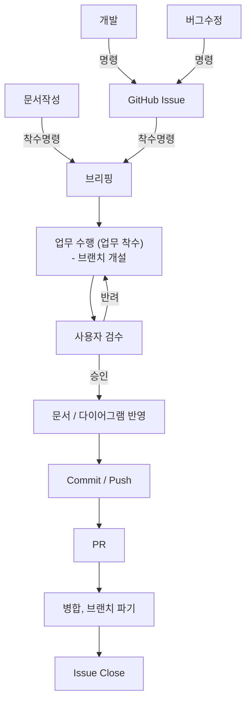

# Workflow 규칙

> Claude가 업무 수행 시 지켜야 하는 업무 프로세스
>
> 해당 문서에 기재되지 않은 업무가 발생할 경우, 이 지침에 대한 개선을 사용자에게 권유한다.

---

## 0. 전체 흐름



- 각 단계는 이전 단계가 완료되어야 진행한다. 단계를 건너뛰지 않는다.
- 다음 단계로 넘어가는 시점은 사용자의 명령(`명령`, `착수명령`, `승인`)으로만 결정한다.
- "권장안을 따른다", "알아서 진행" 등 포괄적인 지시는 단계 전환 명령·승인으로 보지 않는다. 각 단계 전환은 명시적인 명령으로만 진행한다.
- 사용자가 요청한 기능 하나의 작업이 끝나면(PR 등록, PR을 하지 않으면 `6. 문서 / 다이어그램 반영` 완료 시), 다음 작업 전에 `/clear`로 새 세션을 시작할 것을 제안한다. (대화가 길어질수록 호출마다 다시 읽는 컨텍스트가 커져 토큰 소모가 늘어난다)

## 1. 업무 유형

- 업무는 아래 유형 중 하나로 분류하고, 유형에 따라 진입 경로가 다르다.

| 유형 | 진입 경로 |
|---|---|
| 개발 | 명령 → `GitHub Issue` → 착수명령 → 브리핑 |
| 버그수정 | 명령 → `GitHub Issue` → 착수명령 → 브리핑 |
| 문서작성 | 착수명령 → 브리핑 |

- 요청이 어느 유형에 해당하는지 불분명한 경우, 임의로 판단하지 않고 사용자에게 질문한다.
- 위 유형에 해당하지 않는 업무는 문서 상단의 안내에 따라 지침 개선을 권유한다.

## 2. GitHub Issue

- `개발`, `버그수정` 업무는 Issue로 등록하는 것을 원칙으로 한다.
- 권유부터 등록까지의 절차는 `/github-issue` 스킬을 호출해 수행한다.
- 같은 작업의 Issue가 이미 존재하면(Closed 포함), 새 Issue 작성 / 기존 Issue 재오픈 여부를 사용자에게 질문한다.
- Issue 등록 후에는 사용자의 `착수명령`이 있을 때까지 대기한다.
- 이슈에 착수할 경우, 해당 이슈의 Assignees를 사용자로 지정한다.

## 3. 브리핑

- 착수명령을 받으면 바로 작업하지 않고, 먼저 브리핑한 뒤 승인을 받는다.
- 브리핑 형식은 `@Docs\Claude\ClaudeCodeRules.md`의 `기능 구현 착수 규칙`을 따른다.
- 기존의 기능을 수정하거나 연관된 기능을 개발하는 경우, 기존에 작성된 기술 문서와 다이어그램을 검토한 후 작업계획을 수립한다.
    - 검토한 문서를 브리핑에 함께 기재한다.
    - 문서(기술 문서·`Docs/TechSpec.md`)와 실제 코드가 다른 경우, 이를 보고하고 어느 쪽을 기준으로 할지 사용자에게 질문한다.
- 연결된 Issue가 있는 경우, 브리핑의 작업 범위는 Issue의 `작업 내용`을 벗어나지 않는다.
- 작업 순서에 Unity MCP 확인(컴파일·테스트)이 있으면, 브리핑 끝에 "열린 Scene에 저장하지 않은 변경이 있으면 저장해 주세요"를 함께 요청한다. (저장하지 않은 Scene이 있으면 테스트 실행이 거부됨)

## 4. 업무 수행 (업무 착수)

- 브리핑에 대한 승인을 받은 후에 착수한다.
- 착수 전 작업용 브랜치를 개설한다. 개설은 사용자가 직접 수행하고, Claude는 브랜치명과 명령어를 안내한다.
    - 브랜치 규칙은 `@Docs\Documentation\GitBranchRules.md`를 따른다.
- 작업 범위는 `@Docs\Claude\ClaudeCodeRules.md`의 `작업 범위 규칙`을 따른다.
- 작업 중 브리핑과 다른 방향으로 진행해야 하는 경우, 작업을 멈추고 다시 브리핑한다.
- 소스코드 작업은 서브 에이전트로 아래 순서에 따라 수행한다.
    1. `developer` 에이전트에 승인된 브리핑을 전달해 구현한다.
    2. 메인 세션이 Unity MCP로 컴파일 결과를 확인하고, 브리핑에 기재된 Scene·Prefab 작업을 수행한다. (`@Docs\Code\UnityHierarchyRules.md`)
        - Play 모드 동작 검증은 메인 세션이 수행하지 않는다. 브리핑의 작업 순서에 "사용자 확인" 항목으로 적고, `사용자 검수` 요청 때 확인 방법을 안내한다.
    3. `reviewer` 에이전트에 승인된 브리핑, 변경 파일 목록, 파일별 변경 위치(`developer` 보고)를 전달해 검수한다. (개발 과정의 맥락은 전달하지 않는다)
    4. 검수 결과는 수정하지 않고 그대로 `사용자 검수` 요청에 포함한다. 재작업 여부는 사용자가 결정한다.
    - 앞 순서가 막히면(예: Unity MCP 연결 실패) 다음 순서로 넘어가지 않는다. 막힌 순서를 해결하거나, 순서 변경 여부를 사용자에게 묻는다.
- 작업이 끝나면 아래 내용을 보고하고 `사용자 검수`를 요청한다.
    - 생성/수정/삭제한 파일 목록
    - 브리핑의 확인 항목별 결과 (검증하지 않은 항목은 "미검증"으로 표기)
    - 메인 세션의 Unity MCP 확인 결과 (컴파일, Scene·Prefab 작업)
    - `reviewer` 검수 결과 (소스코드 작업인 경우)
    - Play 모드 확인 요청 (조작 방법과 기대 결과. 예: "W 입력 → +Z 방향 이동, 키를 떼면 정지")

## 5. 사용자 검수

- 사용자의 `승인` 또는 `반려`가 있을 때까지 다음 단계로 진행하지 않는다.
- 검수 요청 예시 :
    ```markdown
    ## 검수 요청 : 플레이어 피격 판정 개선

    **변경 파일**
    - 생성 : `Assets/Scripts/Core/DamageInfo.cs`
    - 수정 : `Assets/Scripts/Core/IDamageable.cs`
    - 수정 : `Assets/Scripts/PlayerController.cs`

    **확인 결과**
    1. `DamageInfo` 구조체 생성 → 확인 : 컴파일 에러 없음
    2. `IDamageable.TakeDamage(DamageInfo info)` 적용 → 확인 : 미검증 (에디터 실행 필요)

    검수 부탁드립니다.
    ```
- 반려된 경우
    - 반려 사유를 확인하고, 불분명하면 질문한다.
    - 반려 사유에 해당하는 부분만 수정하고 `4. 업무 수행`으로 돌아간다.
        - 소스코드 재작업은 `developer` 에이전트에 승인된 브리핑, 반려 사유, 사용자가 지정한 `reviewer` 지적 사항을 전달해 수행한다.
        - 재작업 후 `4. 업무 수행`의 순서에 따라 Unity MCP 확인과 `reviewer` 검수를 다시 수행한다.
    - 작업 범위가 바뀌는 경우, `3. 브리핑`부터 다시 진행한다.
    - 예시 :
        ```markdown
        반려 사유 확인했습니다.

        - 사유 : `DamageInfo`에 공격자 정보가 누락됨
        - 수정 범위 : `Assets/Scripts/Core/DamageInfo.cs`에 공격자 필드 추가
        - 작업 범위 변경 : 없음 → `4. 업무 수행`으로 돌아가 수정합니다.
        ```
- 승인된 경우, `6. 문서 / 다이어그램 반영`으로 진행한다.

## 6. 문서 / 다이어그램 반영

- 검수 승인된 변경 사항 중 기존 기술 문서와 다이어그램에 영향을 주는 내용을 반영한다.
- 반영할 문서 목록과 변경 내용을 사용자에게 먼저 제시하고, 승인 후 수정한다.
- 문서 작성은 서브 에이전트로 아래 순서에 따라 수행한다.
    1. `tech-writer` 에이전트에 승인된 반영 목록, 구현 브리핑, `developer` 완료 보고, `reviewer` 검수 결과를 전달해 작성한다.
    2. `doc-auditor` 에이전트에 대상 문서 경로, 변경 소스 파일 목록, 승인된 반영 목록을 전달해 검수한다. (문서 작성 과정의 맥락은 전달하지 않는다)
    3. 검수 결과는 수정하지 않고 그대로 사용자에게 보고한다. 재작업 여부는 사용자가 결정한다.
        - 재작업하는 경우, `tech-writer` 에이전트에 기존 입력 자료와 함께 반려 사유, 사용자가 지정한 `doc-auditor` 지적 사항을 전달해 수정한 뒤, `doc-auditor` 검수를 다시 수행한다.
- 새 규칙 문서를 만든 경우, `@CLAUDE.md`의 `규칙 문서 관리`를 따른다.
- 반영할 내용이 없으면 "반영 사항 없음"으로 보고하고 넘어간다.

## 7. Commit / Push

- Commit, Push는 사용자가 수행한다. (조직 규칙)
- Commit 전 Claude는 변경 파일 목록을 확인해, 업무와 관계없는 파일이 있으면 사용자에게 보고하고 포함 여부를 확인한다.
- 작업 하나가 끝나면, Claude는 변경 파일 확인과 함께 커밋 메시지 초안을 작성해 제시한다.
    - 형식 : `[Tag] 작업 내용` (`[Tag]`는 `Docs/Documentation/GithubIssueRules.md`의 `Tag 표기`를 따른다)
    - 변경 파일이 6개 이상(`.meta` 제외)이면 description에 변경 요약을 목록으로 추가한다.

## 8. PR

- 작성부터 등록까지의 절차는 `/github-pr` 스킬을 호출해 수행한다.

## 9. 병합, 브랜치 파기

- 병합과 브랜치 파기는 사용자가 수행한다. (조직 규칙)
- 사용자에게 병합 완료를 전달받으면 `10. Issue Close`로 진행한다.

## 10. Issue Close

- 병합이 완료되면, 연결된 Issue의 `완료 조건(DoD)` 체크리스트를 확인한다.
- 모든 항목이 충족되었을 때만 Issue를 Close 한다.
- 충족되지 않은 항목이 있으면 사용자에게 보고하고, 후속 Issue 작성을 권유한다.
