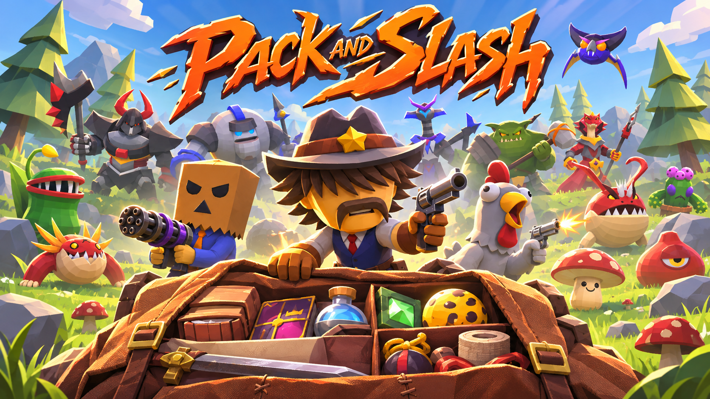

## 게임 소개

**Pack & Slash**는 몰려오는 몬스터를 자동 사격으로 쓰러뜨리며 버티는 탑다운 서바이벌 게임입니다.
레벨업할 때마다 가방(격자 인벤토리)에 무기와 패시브 아이템을 배치하고, 같은 아이템을 합성해 강해지세요.

- 캐릭터 3종 중 하나를 골라 시작 무기와 고유 아이템을 들고 출발합니다.
- 무기는 자동으로 사격하며, 몬스터를 처치하면 경험치 보석이 떨어집니다.
- 레벨업하면 전투가 멈추고 보상 3개 중 최대 2개를 골라 가방에 배치합니다.
- 같은 종류·같은 레벨 아이템을 겹쳐 합성하면 레벨이 오르고 생김새도 바뀝니다.
- 패시브 아이템을 무기 옆에 붙이면 인접 시너지가 발동합니다.
- 중간 보스를 처치하면 가방이 4칸 확장됩니다.

## 조작법

| 입력 | 동작 |
|---|---|
| `W` `A` `S` `D` (방향키) | 이동 |
| `R`(회전) | 아이템 회전 |
| 자동 | 무기 사격 |
| 마우스 드래그 | 인벤토리 아이템 이동·배치·합성 |

## 이번 버전 주요 변경

- 레벨업 인벤토리 화면 UI (#18)
- 보스·강화몹·대량 스폰 (#20)
- 인벤토리 UI 및 아이템 배치 (#22)
- 보스 처치 인벤토리 4칸 확장 (#24)
- 소비 아이템 2종 (#26)
- 타이틀 화면 배경·버튼·폰트 (#28)
- 아이템 레벨별 아이콘 (#30)

---
# 특이사항 - 미구현 사항

### 무기 진화(패시브 아이템 & 무기 5레벨 달성 시 재화 사용)는 미구현입니다.
### 사운드, 이펙트는 미구현입니다.
### 레벨업 시 아이템 2개, 보스 처치시 아이템 3개를 반드시 선택해주셔야 아이템 배치가 가능합니다.
### 합성은 같은 레벨의 동일 아이템끼리만 가능합니다.
